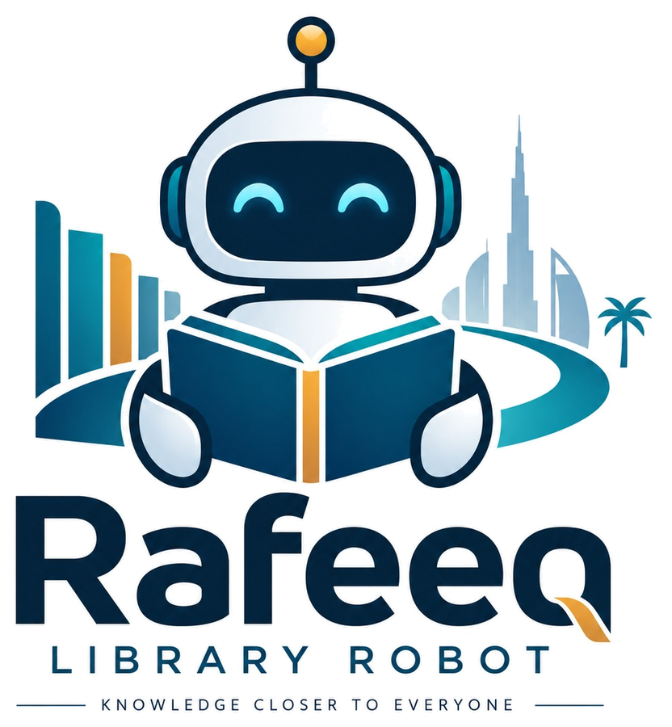
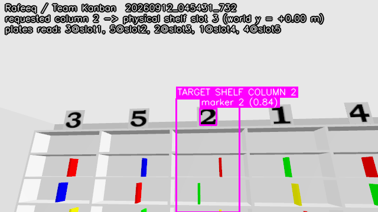
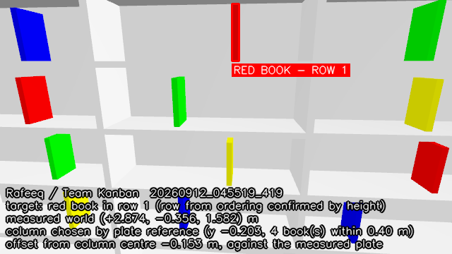

<div align="center">



**Autonomous book retrieval on TIAGo Pro**
Emirates Robotics Competition 2026 · Phase 1 · **Team Kanban**, Al Ain University

</div>

---

Rafeeq finds a book on a library shelf and puts it in the collection bin. You
give it a shelf number and a colour; it reads the shelf's number plates to work
out which physical column that is, finds the book of that colour, **measures
where the book actually is**, drives up to it, grasps it, pulls it out of the
shelf and delivers it.

The name is Arabic for *companion*. The long-term goal is a library assistant
that makes shelves reachable for people who cannot reach them — see
[Vision](#vision-and-future-work). This repository is the Phase 1 simulation
entry towards that.

## What has been demonstrated

The task has been completed end to end on the live simulator, in one unedited
take, and the completion was reported by the organisers' own contact sensor —
not by our gripper opening.

**The recorded run.** `ERC_SEED=101`, `shelf_column_number:=2`,
`book_colour:=red`, recorded by [`tools/record_trial.sh`](tools/record_trial.sh)
as one continuous take with a live trial timer. Times are simulated seconds
from mission start, as the mission node logs them; each row is timed at the
moment the stage that established it handed over.

| t (sim) | What happened |
|---|---|
| +23.5 s | Collection bin identified visually from the start zone, before the shelf trip |
| +34.7 s | Number plate **2** read above **physical column 3** |
| +51.9 s | Red book found in **row 1** and its 3D position measured |
| +94.1 s | Grasped and lifted |
| +99.3 s | Clear of the shelf, retention confirmed on fingertip contact |
| +107.8 s | Released over the bin and delivered |

The line that ends the run is the organisers' `/bin_contacts` topic reporting
the book itself:

```
OFFICIAL COMPLETION EVENT: book_col_3_row_2_red contacted the collection bin at t+107.8 s
```

The model name is the simulator's own, and it is a consistency check made after
the fact rather than anything the solution selects on: `col_3` is the physical
column the plate numbered 2 hangs above — the slot the printed plate **2** hangs
over — and SDF `row_2` is competition row 1.

**Two clocks, and they do not disagree.** The `t+` figures above are
**simulated** seconds (`use_sim_time`). The on-screen timer in the video is wall
clock, started when `solution.launch.py` is launched; it read 221.3 s at the
delivery and freezes there on **BOOK DELIVERED**. 107.8 s of simulation inside
221.3 s of wall clock is a realised real-time factor of 0.487 for this take,
with the viewer and a screen recorder running — and a lower bound, because the
timer starts before the mission clock does. The video is 4:34 long, title card
included, 1920×1080 at 15 fps.

One collision was recorded in the take, and it was with the book rather than the
shelf: `arm_right_6_link` brushed `book_col_3_row_2_red` during the retreat
(−0.5 under the local scoring estimate).

**What that does and does not prove.** It proves the whole pipeline closes:
identification, measurement, grasp, extraction, carry and delivery, with no
operator input and no ground truth consulted by the solution. It does not make
the run repeatable on demand. The carry is timing-critical — see
[The grip is a clock](#the-grip-is-a-clock) — and runs can still drop the book.
This repository claims a demonstrated completion, not a guaranteed one.

**Identification is the part that is broadly sampled.** Five recorded trials in
[`results/`](results/) cover five layout seeds, five different columns and all
four colours. Column and row were identified, published and photographed
correctly on every one, and the measured offset of the chosen book from its
column centre averaged **0.145 m**, largest **0.254 m**, against an organiser
jitter of ±0.25 m — a book from a neighbouring column would be about a metre
out. Those five records predate the extraction fix: each one ends
`"outcome": "failed"` at the retention check, and they are kept as the
identification and measurement evidence they are, not as delivery evidence.

<div align="center">


<br/>
<sub>Written by the solution <b>during the delivering run itself</b>, not staged
afterwards. Left: every plate read and the mapping it produced — <i>requested
column 2 → physical shelf slot 3</i>, plates <code>3@slot1, 5@slot2, 2@slot3,
1@slot4, 4@slot5</code>, which is why the delivered model is named
<code>book_col_3_…</code>. Right: the chosen book with its measured world
position and its offset from the column centre.</sub>
</div>

## What we built

The organisers supply the arena, the task and the TIAGo Pro integration. Team
Kanban wrote everything in [`src/rafeeq_solution/`](src/rafeeq_solution/) — four
ROS 2 nodes and six ROS-free modules, about 10 000 lines, with 162 offline tests
that need neither ROS nor Gazebo to run.

| What we had to build | Why it was not off the shelf |
|---|---|
| **A grasp planner that solves poses from a measurement** ([`grasp.py`](src/rafeeq_solution/rafeeq_solution/grasp.py)) | The organisers jitter every book by up to ±0.25 m — three times the gripper's 0.082 m opening — so stored poses aimed at column centres miss almost every book. Poses are solved per run from where the book actually is. |
| **Our own inverse kinematics** ([`kinematics.py`](src/rafeeq_solution/rafeeq_solution/kinematics.py)) | The repository ships no MoveIt configuration for TIAGo Pro: no SRDF, no planning group, no kinematics plugin. We parse the competition URDF and solve the 8-DOF chain with damped least squares, seeded from a sampled workspace. Its forward kinematics matches the running simulator to **0.07 mm**. |
| **Holonomic waypoint navigation** ([`navigation_node.py`](src/rafeeq_solution/rafeeq_solution/navigation_node.py)) | `simulation.launch.py` never brings Nav2 up — no map server, no AMCL, no costmaps, no `map` frame. We drive odometry waypoints directly, with a separate speed, acceleration and tolerance profile per leg, because the leg that carries a book cannot be driven like the leg that does not. |
| **Perception that measures, not guesses** ([`perception_node.py`](src/rafeeq_solution/rafeeq_solution/perception_node.py), [`vision.py`](src/rafeeq_solution/rafeeq_solution/vision.py)) | Digit-template plate reading, HSV book detection with row ordering confirmed by height, and depth deprojection that takes the book's near surface rather than a median blended with the shelf behind it. |
| **A state machine where nothing advances on a timeout** ([`mission_node.py`](src/rafeeq_solution/rafeeq_solution/mission_node.py)) | Thirty-three states, each gated on an observation. Sixteen of them originally treated a timeout as success — the single largest class of defect we found in our own code. |
| **A trial recorder that refuses to record a bad take** ([`tools/record_trial.sh`](tools/record_trial.sh)) | It abandons a take if the arena never spawns, if the controller spawners lose their startup race, or if the viewer came up without the robot in its scene — the last one after a finished, delivering take had to be thrown away because the robot was not in the picture. |

The harder half of the work was not writing that code but finding out why it
did not work. Everything measured along the way is in
[`docs/measured_environment.md`](docs/measured_environment.md),
[`docs/grasp_blocker.md`](docs/grasp_blocker.md) and
[`docs/odometry_drift.md`](docs/odometry_drift.md), with the diagnostics that
reproduce each number in [`tools/diagnostics/`](tools/diagnostics/).

## Quick start for judges

Two terminals. Nothing else — no browser, no dashboard, no second "go" command,
no manual arm tuning.

**Terminal 1 — the official simulation, unmodified:**

```bash
ros2 launch erc_bringup simulation.launch.py
```

**Terminal 2 — Rafeeq:**

```bash
ros2 launch rafeeq_solution solution.launch.py shelf_column_number:=2 book_colour:=red
```

`shelf_column_number` is 1–5 and `book_colour` is one of `red`, `blue`,
`green`, `yellow`. Anything else is rejected with a clear message *before* the
robot moves. Every other argument has a working default.

Getting the container up from scratch is in [Installation](#installation).

## What happens in a run

One state machine, thirty-three states, every one of them gated on an
observation. Nothing advances on a timeout.

1. **Wait for readiness**, observed — controllers and joint states, not a sleep.
2. **Find the bin first.** The robot turns on the spot in the start zone and
   identifies the collection bin visually before it ever goes to the shelf.
   This is the single change that made delivery possible; the reason is below.
3. **Read the shelf.** Turn to the shelf, scan the number plates, find the plate
   carrying the requested number, and publish the column on
   `/erc/shelf_column_identification` once it has actually been read.
4. **Drive to that column**, re-read its plate from the book-scan pose, find the
   book of the requested colour, publish its row on
   `/erc/shelf_row_identification`, and **measure the book's 3D position**.
5. **Plan a grasp** from that measurement, take the posture while still clear of
   the shelf, then let the holonomic base carry the open gripper in.
6. **Close on contact**, lift, and **reverse the base 0.34 m** to pull the book
   out of the shelf on a gentle ramped goal.
7. **Confirm the hold** on sustained fingertip contact — while the drive to the
   bin has already started.
8. **Drive straight to the release pose**, lowering the torso on the way, and
   drop the book into the bin.
9. **Confirm delivery** on `/bin_contacts`, back off, and write the trial record.

## Where the evidence is

| What | Where |
|---|---|
| Annotated identification images, written live during a run | [`erc_images/`](erc_images/) |
| Machine-readable trial records (one JSON per run) | [`results/`](results/) |
| The delivering take's logs, opening and closing frames, and checksums | [`media/`](media/) |
| The trial recorder, and what it refuses to record | [`tools/record_trial.sh`](tools/record_trial.sh) |
| Requirement-by-requirement status | [`docs/competition_readiness.md`](docs/competition_readiness.md) |
| Every measured number, and the baseline it was measured against | [`docs/measured_environment.md`](docs/measured_environment.md) |
| What stopped the grasp, and what fixed it | [`docs/grasp_blocker.md`](docs/grasp_blocker.md) |
| Why odometry drift shaped several design choices | [`docs/odometry_drift.md`](docs/odometry_drift.md) |
| Reproducing every measured number | [`tools/diagnostics/`](tools/diagnostics/) |
| Phase 1 report | `report/Rafeeq_ERC2026_Phase1_Report.pdf` |

`record_trial.sh` writes the video to `$OUT` (default `/tmp/rafeeq_trial.mp4`)
with the run's solution and simulator logs, and the frame the trial starts from
(`<video>_first_frame.png`), beside it. The video is not committed here; the
delivering take is submitted as `Rafeeq_Phase1_TeamKanban_delivered.mp4`
(11.7 MiB).

That take has **no JSON record** in `results/`. The recorder ends a take on the
organisers' `/bin_contacts` event — the book in the bin is the task being
finished — so the take ends there, no record was written for it, and its log
carries the completion event rather than a `RUN … COMPLETE` line. The records in
`results/` are the five identification trials described above.

## Architecture

Four nodes, deliberately separable. Perception never talks to manipulation;
the mission node is the only thing that decides anything.

```
                     ┌───────────────────────────────────────────────┐
                     │             rafeeq_mission                    │
                     │  state machine · scoring · trial record       │
                     │  nothing advances on a timeout                │
                     └───┬───────────┬───────────────┬───────────────┘
        /perception/mode │           │ /manip/command│ /nav/goal
        /perception/…    │           │ /manip/status │ /nav/status
                         ▼           ▼               ▼
        ┌────────────────────┐ ┌───────────────┐ ┌──────────────────┐
        │ rafeeq_perception  │ │ rafeeq_       │ │ rafeeq_          │
        │                    │ │ manipulation  │ │ navigation       │
        │ digit templates    │ │ FollowJoint   │ │ holonomic        │
        │ HSV book detect    │ │ Trajectory    │ │ waypoints on     │
        │ depth → world      │ │ actions       │ │ odometry         │
        │ evidence images    │ │ grasp planner │ │ 360° clearance   │
        └─────────┬──────────┘ └───────┬───────┘ └────────┬─────────┘
                  │                    │                  │
   RGB-D, CameraInfo, TF        arm/torso/head actions   /cmd_vel, /odom
                                gripper *public* topic   /scan_front_raw
                                /joint_states, /contacts /scan_rear_raw
                                        │
                  ┌─────────────────────┴──────────────────────┐
                  │  supporting modules (no ROS, unit-testable) │
                  │  arena · vision · image_utils               │
                  │  kinematics (URDF DLS IK) · grasp · scoring  │
                  └─────────────────────────────────────────────┘
```

**Competition outputs** — `/erc/shelf_column_identification` and
`/erc/shelf_row_identification` (`std_msgs/Int32`, latched), published only
after the corresponding marker has actually been identified in an image.

**Official inputs consumed** — `/bin_contacts` for the delivery event and
`/contacts` for collision scoring, both as published by
`erc_bringup/simulation.launch.py`.

### Why not Nav2, why not MoveIt

Both are installed in the image; neither is *used*, and the README does not
pretend otherwise.

* **Nav2** is never brought up by `simulation.launch.py` — there is no map
  server, no AMCL, no costmap and no `map` frame, only `odom → base_footprint`.
  The arena's fixed furniture does not need SLAM. Rafeeq drives holonomic
  waypoints on odometry and publishes both the intended waypoint path
  (`/rafeeq/nav/planned_path`) and the executed trajectory
  (`/rafeeq/nav/executed_path`) as `nav_msgs/Path`, labelled as what they are.
* **MoveIt** has nothing to plan against here: the repository ships no SRDF, no
  planning group and no kinematics plugin for TIAGo Pro. `kinematics.py` parses
  the competition URDF and solves the 8-DOF chain (torso + 7 arm joints) with
  damped least squares, seeded from a sampled workspace. `grasp.py` turns a
  measured book position into a validated posture.

## What makes the grasp hard here

Worth stating, because it drove most of the engineering. All measured, not
assumed — see [`docs/measured_environment.md`](docs/measured_environment.md)
and [`docs/grasp_blocker.md`](docs/grasp_blocker.md).

* The organiser randomises **three** things per run, not one: which plate is
  over which column, which row holds each colour (per column), and each book's
  horizontal position by **±0.25 m**. A grasp aimed at a column centre misses,
  so the book's position has to be measured and used.
* A book presents its **spine, 0.03 m wide**. Only that dimension fits between
  the pads, so the fingers must close along world *y* — which fixes the
  gripper's roll up to one free parameter.
* That free parameter matters enormously. The gripper body is **0.174 m long**
  along the axis perpendicular to the fingers. With a horizontal approach that
  axis is *vertical*, and a shelf row is only **0.300 m** tall with a 0.250 m
  book already in it. Rafeeq searches wrist roll × grasp height × approach tilt
  and picks a combination that keeps every link out of the shelf structure —
  which is why the arm enters the row with **zero** `erc_shelf` contacts, where
  earlier attempts logged thousands.
* **Grasp above the centre of mass, or lose the book.** The pads can only reach
  the front ~0.06 m of a 0.16 m-deep book, and a two-pad pinch has almost no
  stiffness about its own axis: the book hangs from the pinch as soon as its
  rear leaves the board. Pinched 0.054 m *below* centre — the first clean
  candidate the planner used to take — that is an inverted pendulum: measured in
  ground truth, the book came 0.17 m out of the shelf still held, then flipped
  over the pads and fell. The planner now searches grasps **above** the centre
  first (measured +0.072 m up the spine, wrist roll −*y*, approach tilt −90° or
  −70°), and accepts one only if the lift that unloads the book also solves.
* The final approach is performed by the **base**, not the arm: the arm takes
  one validated posture while still clear of the shelf, then the holonomic base
  translates the whole robot straight in, to a 0.006 m stop tolerance at
  0.30 m/s. Re-solving IK inside the row changes the arm's posture between
  waypoints, and the controller interpolates straight through whatever lies
  between them.
* **Closing is a search, not a command.** The fingers step in until a pad
  reports contact, then squeeze by `CLOSE_SQUEEZE` (0.010), clamped so the
  final pad gap is never slacker than `CLOSE_TARGET_GAP` — 0.0199 m on a
  0.030 m spine. Commanding the closed position in one move drives the fingers
  *through* the book, and what that reported as a grasp never survived a lift.

### The grip is a clock

There is no attach or detachable-joint mechanism anywhere in the organisers'
world or robot — the word "detachable" does not appear in `src/` at all — so the
book is held by friction between two pads. Those pads sit on mimic joints whose
URDF effort limit is **0.1 N m**, and once that servo saturates the book's
weight back-drives the fingertip and the book creeps out. Measured: once the
book hangs free, it stays held **6–11 s**.

That is why the return was rebuilt. The old route — drive to the start zone,
search for the bin, line up, plan a placement — took 25–40 s and dropped the
book every time. Now the bin is identified *before* the shelf trip, the drive
to the release pose starts while the hold check is still running, the torso
lowers on the way (at most 0.15 m), and the book is released over the bin's
mouth. The whole carry is made to fit inside the time the grip lasts. In the
recorded take it did, and not by much: `CARRY_TO_BIN` at t+99.3 s to `RELEASE`
at t+107.1 s is **7.8 s** of carry against a 6–11 s grip.

What breaks the grip is **acceleration, not speed**. Measured by how far the
book survived:

| Linear acceleration | Speed cap | Book dropped after |
|---|---|---|
| 0.30 m/s² | 0.45 m/s | 0.92 m |
| 0.15 m/s² | 0.12 m/s | 0.95 m |
| 0.15 m/s² | 0.45 m/s | 1.75 m |

So legs carried with a book keep a high top speed (0.45 m/s, 0.60 rad/s) and
ramp at **0.08 m/s² and 0.12 rad/s²**, in the odom frame so the ramp does not
fight the 180° turn, limited only on speeding up so the base can still stop.
They arrive to 0.06 m and 0.04 rad. Ordinary legs run at 0.50 m/s and
0.90 rad/s; arm and torso trajectories run at 0.80 of the URDF velocity limits.

## Installation

Prerequisites and the container are the organisers': x86_64 Linux host with
Docker, or WSL2. The full original instructions are preserved in
[`docs/organiser_README.md`](docs/organiser_README.md).

```bash
git clone https://github.com/4waiz/Rafeeq-library.git
cd Rafeeq-library

./docker/up.sh --build          # build the image and start the container
./docker/attach.sh              # shell inside it

# inside the container
colcon build --symlink-install
source install/setup.bash
```

Then the two commands in [Quick start](#quick-start-for-judges).

### Launch arguments

| Argument | Default | Meaning |
|---|---|---|
| `shelf_column_number` | *required* | Target shelf column, 1–5 |
| `book_colour` | *required* | `red`, `blue`, `green` or `yellow` |
| `arm_side` | `right` | Which single arm grasps. The other is tucked. |
| `image_dir` | `<workspace>/erc_images` | Where evidence images are written |
| `results_dir` | `<workspace>/results` | Where the trial record is written |
| `row_one_is_top` | `true` | Row 1 is the topmost occupied row |
| `auto_start` | `true` | Start on readiness; `false` waits for `/rafeeq/mission/start` |
| `use_sim_time` | `true` | Follow the Gazebo clock. Leave true. |
| `run_id` | generated | Identifier for the trial record |

### Reproducible layouts

`simulation.launch.py` seeds its randomisation from `ERC_SEED`, which makes a
layout repeatable and is how the trials in `results/` and the recorded run were
launched:

```bash
ERC_SEED=101 ros2 launch erc_bringup simulation.launch.py
```

### Recording a competition trial

```bash
tools/record_trial.sh 2 red 101        # column, colour, seed
```

Run inside the container, on a virtual X display of its own. It produces the
take the Phase 1 document asks for: team title card first, then
`simulation.launch.py` and `solution.launch.py` typed and launched on camera, a
live trial timer beside them, one continuous take, no cuts and no speed-up. It
abandons a take early — printing the simulator's own log — if the arena never
spawns all 20 books, if the organisers' controller spawners lose their startup
race, or if the viewer has no robot in its scene. All three happen
intermittently on this machine.

That last one cost a finished take. Gazebo's viewer builds its scene from
whatever the server has the instant it connects, and the robot is spawned into
the world after the arena is: when the viewer is started alongside the server
it can lose that race, and then the recording shows the shelf, the table and
the bin with nothing between them for the whole run — a real delivery with no
robot on camera. The script now starts the world without its viewer and
attaches the viewer once `tiago_pro` is in the model list, so the scene it
builds already has the robot in it. Then it checks: asking the viewer to follow
the robot returns the follow target named when the viewer has it and empty when
it does not, which is the only answer the viewer gives about its own scene. A
take that fails that check is restarted once and then abandoned.

Gazebo renders on the GPU through Mesa's `d3d12` driver under WSL, which the
script sets up when it finds it. That takes the real-time factor from 0.36 in
software to **0.65–0.70** headless, 0.56 with the viewer up, which is what fits
an unedited real-time run inside the five-minute limit — the delivering take
realised 0.487 up to the delivery, with the viewer and the screen recorder both
running.
Only the rendering changes; the physics and the solution are identical.

The viewer's window is made 1700 px wide against the 1280 px the recording
gives it, so Gazebo's world and entity-tree panels fall behind the terminal
column and the whole recorded width goes to the arena.

### Testing

```bash
python3 -m pytest src/rafeeq_solution/test -q        # 162 offline tests
python3 src/rafeeq_solution/scripts/test_vision_offline.py   # 23 vision tests
```

No ROS, no Gazebo, no robot needed for either. Run them before every attempt.

## Troubleshooting

| Symptom | Cause and fix |
|---|---|
| Mission sits in `WAIT_READY` | A controller has not come up. Rafeeq waits for observed readiness rather than sleeping; check `ros2 action list` for `follow_joint_trajectory`. `record_trial.sh` abandons a take for exactly this. |
| The arena spawns but the robot never moves | The organisers' launch races its own `controller_manager`; spawners can die with *"Failed loading controller"*. Relaunch the simulation. |
| `invalid launch arguments` | `shelf_column_number` must be 1–5 and `book_colour` one of the four. The message lists what it got. |
| No evidence images appear | Check `image_dir` in the launch log. Rafeeq resolves it from the parameter, then `ERC_IMAGES_DIR`, then the workspace — it never needs write access to `/`. |
| Perception logs *"camera frames are stamped ahead of /tf"* | Expected on this bridge — images arrive ~1.7 s ahead of the transforms. Rafeeq uses the latest transform only while the base is stationary and drops frames while moving. |
| The book is dropped on the way to the bin | The grip lasts 6–11 s once the book hangs free. The run fails explicitly and says so; it does not pretend to have delivered. |
| Everything runs but slowly | Real-time factor was measured at **0.362** in software on the validation machine, 0.65–0.70 on the GPU headless and 0.56 with the viewer up. Sim seconds ≠ wall seconds: the trial records are in simulated seconds (`simulated_seconds_total`), the video's timer is wall clock. |
| Two simulations at once | Two `gz sim` servers on one `ROS_DOMAIN_ID` serve the same topics from different worlds and every measurement becomes a coin flip. Make sure only one is running. |

## Repository structure

```
├── src/rafeeq_solution/         our solution package
│   ├── rafeeq_solution/
│   │   ├── mission_node.py      state machine, scoring, trial records
│   │   ├── perception_node.py   markers, books, bin, evidence images
│   │   ├── navigation_node.py   holonomic waypoints, 360° clearance
│   │   ├── manipulation_node.py arm/torso/head/gripper with real checks
│   │   ├── grasp.py             measured pose → validated grasp plan
│   │   ├── kinematics.py        URDF-parsed DLS IK (no ROS)
│   │   ├── vision.py            detectors (no ROS)
│   │   ├── image_utils.py       Image ↔ numpy, pinhole deprojection
│   │   ├── arena.py             measured arena facts and frames
│   │   └── scoring.py           practice scoring, collisions, delivery
│   ├── test/                    offline regression tests
│   ├── launch/solution.launch.py
│   └── config/arm_poses.yaml
├── src/erc_bringup, erc_description, …   organisers' packages, unmodified
├── docs/                        measurements, readiness, grasp, organiser README
├── tools/record_trial.sh        one-take competition recording
├── tools/diagnostics/           scripts that reproduce the measured numbers
├── erc_images/                  live evidence images
├── results/                     machine-readable trial records
└── report/                      Phase 1 report
```

## Vision and future work

Rafeeq exists because a library is only as accessible as its top shelf. The
intent is an assistant that fetches books for people who cannot reach or
navigate the stacks — wheelchair users, people with limited mobility, and
visually impaired readers.

**None of that is implemented yet.** There is no Arabic voice interface, no
accessibility testing, and no deployment with People of Determination. Phase 1
is a simulated retrieval task, and that is all this repository demonstrates.
The accessibility work is the motivation and the roadmap, not a claim.

Nearer-term, concrete work:

1. Make the carry robust rather than timing-critical. Everything downstream of
   the lift currently races a grip that lasts 6–11 s.
2. Repeat the delivery across seeds and columns, and record the rate, the way
   identification is recorded now.
3. Collision-aware trajectory checking, rather than the coarse advisory model
   currently used to rank IK solutions.
4. Gentle placement instead of a drop, which is worth more under the rubric.

## Acknowledgements

* **Emirates Robotics Competition 2026** organisers, [`dfl-rlab/erc_sim_2026`](https://github.com/dfl-rlab/erc_sim_2026) — the arena, the task, the TIAGo Pro integration and the whole simulation environment. Rafeeq is built on their work; their original README is preserved at [`docs/organiser_README.md`](docs/organiser_README.md).
* **PAL Robotics** — TIAGo Pro, the PAL Pro gripper, and the `pal_*` and `launch_pal` packages vendored under `src/`, under their own licences.
* **`gz_ros2_control`** and the ROS 2 / Gazebo communities.

Third-party code under `src/` retains its original licences and copyright.
`src/rafeeq_solution/` is Team Kanban's own work.

---

<div align="center">
<sub><b>Team Kanban</b> · Al Ain University · Mentor: Yazan Alahmed<br/>
Emirates Robotics Competition 2026 — Phase 1</sub>
</div>
