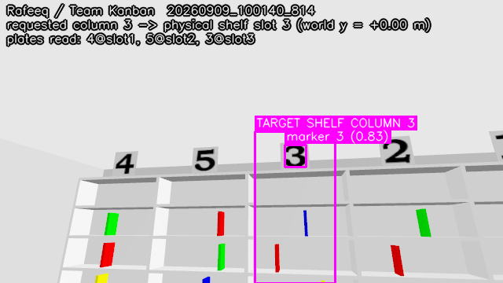
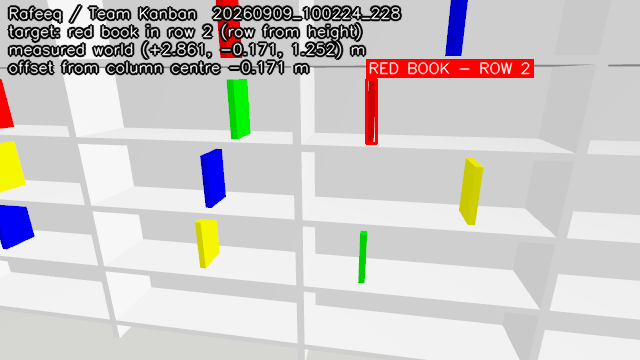

<div align="center">


# Rafeeq — Library Robot

**Autonomous book retrieval on TIAGo Pro**
Emirates Robotics Competition 2026 · Phase 1 · **Team Kanban**, Al Ain University

</div>

---

Rafeeq finds a book on a library shelf and brings it back. You give it a shelf
number and a colour; it reads the shelf's number plates to work out which
physical column that is, finds the book of that colour, **measures where the
book actually is**, drives up to it, and reaches for it.

The name is Arabic for *companion*. The long-term goal is a library assistant
that makes shelves reachable for people who cannot reach them — see
[Vision](#vision-and-future-work). This repository is the Phase 1 simulation
entry towards that.

## What has actually been demonstrated

Honesty first, because it is the point of the whole exercise. Verified on the
live simulator, with evidence in this repository:

Rates are over the 5 recorded trials in [`results/`](results/) — five layout
seeds, five different columns, all four colours.

| | Stage | Status |
|---|---|---|
| ✅ | Read the shelf number plates and identify the target **column** | **5/5** |
| ✅ | Publish `/erc/shelf_column_identification` **after** identification | 5/5 |
| ✅ | Annotated image with a box around the **column** | 5/5 |
| ✅ | Drive to the identified column | 5/5 |
| ✅ | Identify the target book's **row** and publish it | **5/5** |
| ✅ | **Measure the book's 3D position** and use it to aim | **5/5** |
| ✅ | Annotated image of the book with its row and measured offset | 5/5 |
| ✅ | Stage, plan and reach into the shelf with **zero shelf collisions** | 5/5 attempted |
| ✅ | Close the gripper on the book, with registered contact | 5/5 attempted |
| ❌ | **Retain** the book through a lift or a retreat | **blocked** |
| ⏳ | Carry back, identify the bin, place, verify delivery | implemented, never reached live |

The identification rates are worth a sentence, because "5/5" on its own could
mean the robot found *a* book. Across the five trials the measured offset of
the chosen book from its column centre averaged **0.157 m**, largest 0.266 m,
against an organiser jitter of ±0.25 m. A book from a neighbouring column would
be about a metre out. Spot-checked against Gazebo ground truth on the case that
used to fail worst: −0.266 m recorded against −0.246 m true.

**One thing is honestly not working, and one is costing points.**

1. **The grasp does not hold.** The gripper reaches the right book, closes on
   it and registers contact, but the book is not retained. Characterised in
   **[docs/grasp_blocker.md](docs/grasp_blocker.md)** with a reproducer.
   Everything gated on it — the grasp points, both navigation awards and the
   placement points — is **not earned**, and this repository does not claim
   them.
2. **The tucked left arm brushes the table** as the base turns to face the
   shelf. It is the only collision in the five trials and it occurs in all of
   them: −0.5 each, 2.5 across the set.

Mean estimated score across the recorded trials: **5.5 / 19**.

What that leaves is a working perception-to-motion pipeline and a mission that
**reports failure honestly instead of manufacturing success**. An earlier
version of this code treated a timeout as completion in sixteen places and
logged `MISSION COMPLETE — book delivered to the collection bin` on runs where
nothing had happened at all. That is gone.

<div align="center">


<br/>
<sub>Live evidence written by the running solution during a trial: the target
shelf column, and the target book with its measured position.</sub>
</div>

## Quick start for judges

Two terminals. Nothing else — no browser, no dashboard, no second "go" command,
no manual arm tuning.

**Terminal 1 — the official simulation, unmodified:**

```bash
ros2 launch erc_bringup simulation.launch.py
```

**Terminal 2 — Rafeeq:**

```bash
ros2 launch rafeeq_solution solution.launch.py shelf_column_number:=2 book_colour:=red
```

`shelf_column_number` is 1–5 and `book_colour` is one of `red`, `blue`,
`green`, `yellow`. Anything else is rejected with a clear message *before* the
robot moves. Every other argument has a working default.

Getting the container up from scratch is in [Installation](#installation).

## Where the evidence is

| What | Where |
|---|---|
| Annotated identification images, written live during a run | [`erc_images/`](erc_images/) |
| Machine-readable trial records (one JSON per run) | [`results/`](results/) |
| Requirement-by-requirement status | [`docs/competition_readiness.md`](docs/competition_readiness.md) |
| Every measured number, and the baseline it was measured against | [`docs/measured_environment.md`](docs/measured_environment.md) |
| The open blocker, with a reproducer | [`docs/grasp_blocker.md`](docs/grasp_blocker.md) |
| Why odometry drift shaped several design choices | [`docs/odometry_drift.md`](docs/odometry_drift.md) |
| Reproducing every measured number | [`tools/diagnostics/`](tools/diagnostics/) |
| Phase 1 report | `report/Rafeeq_ERC2026_Phase1_Report.pdf` |
| Demonstration video | **not yet recorded** — there is no successful run to record |

## Architecture

Four nodes, deliberately separable. Perception never talks to manipulation;
the mission node is the only thing that decides anything.

```
                     ┌───────────────────────────────────────────────┐
                     │             rafeeq_mission                    │
                     │  state machine · scoring · trial record       │
                     │  nothing advances on a timeout                │
                     └───┬───────────┬───────────────┬───────────────┘
        /perception/mode │           │ /manip/command│ /nav/goal
        /perception/…    │           │ /manip/status │ /nav/status
                         ▼           ▼               ▼
        ┌────────────────────┐ ┌───────────────┐ ┌──────────────────┐
        │ rafeeq_perception  │ │ rafeeq_       │ │ rafeeq_          │
        │                    │ │ manipulation  │ │ navigation       │
        │ digit templates    │ │ FollowJoint   │ │ holonomic        │
        │ HSV book detect    │ │ Trajectory    │ │ waypoints on     │
        │ depth → world      │ │ actions       │ │ odometry         │
        │ evidence images    │ │ grasp planner │ │ 360° clearance   │
        └─────────┬──────────┘ └───────┬───────┘ └────────┬─────────┘
                  │                    │                  │
   RGB-D, CameraInfo, TF        arm/torso/head actions   /cmd_vel, /odom
                                gripper *public* topic   /scan_front_raw
                                /joint_states, /contacts /scan_rear_raw
                                        │
                  ┌─────────────────────┴──────────────────────┐
                  │  supporting modules (no ROS, unit-testable) │
                  │  arena · vision · image_utils               │
                  │  kinematics (URDF DLS IK) · grasp · scoring  │
                  └─────────────────────────────────────────────┘
```

**Competition outputs** — `/erc/shelf_column_identification` and
`/erc/shelf_row_identification` (`std_msgs/Int32`, latched), published only
after the corresponding marker has actually been identified in an image.

**Official inputs consumed** — `/bin_contacts` for the delivery event and
`/contacts` for collision scoring, both as published by
`erc_bringup/simulation.launch.py`.

### Why not Nav2, why not MoveIt

Both are installed in the image; neither is *used*, and the README does not
pretend otherwise.

* **Nav2** is never brought up by `simulation.launch.py` — there is no map
  server, no AMCL, no costmap and no `map` frame, only `odom → base_footprint`.
  The arena's fixed furniture does not need SLAM. Rafeeq drives holonomic
  waypoints on odometry and publishes both the intended waypoint path
  (`/rafeeq/nav/planned_path`) and the executed trajectory
  (`/rafeeq/nav/executed_path`) as `nav_msgs/Path`, labelled as what they are.
* **MoveIt** has nothing to plan against here: the repository ships no SRDF, no
  planning group and no kinematics plugin for TIAGo Pro. `kinematics.py` parses
  the competition URDF and solves the 8-DOF chain (torso + 7 arm joints) with
  damped least squares, seeded from a sampled workspace. `grasp.py` turns a
  measured book position into a validated posture.

## What makes the grasp hard here

Worth stating, because it drove most of the engineering. All measured, not
assumed — see [`docs/measured_environment.md`](docs/measured_environment.md).

* The organiser randomises **three** things per run, not one: which plate is
  over which column, which row holds each colour (per column), and each book's
  horizontal position by **±0.25 m**. A grasp aimed at a column centre misses,
  so the book's position has to be measured and used.
* A book presents its **spine, 0.03 m wide**. Only that dimension fits between
  the pads, so the fingers must close along world *y* — which fixes the
  gripper's roll up to one free parameter.
* That free parameter matters enormously. The gripper body is **0.157 m long**
  along the axis perpendicular to the fingers. With a horizontal approach that
  axis is *vertical*, and a shelf row is only **0.300 m** tall with a 0.250 m
  book already in it. Rafeeq searches wrist roll × grasp height × approach tilt
  and picks a combination that keeps every link out of the shelf structure —
  which is why the arm now enters the row with **zero** `erc_shelf` contacts,
  where earlier attempts logged thousands.
* The final approach is performed by the **base**, not the arm: the arm takes
  one validated posture while still 1.35 m clear of the shelf, then the
  holonomic base translates the whole robot straight in. Re-solving IK inside
  the row changes the arm's posture between waypoints, and the controller
  interpolates straight through whatever lies between them.

## Installation

Prerequisites and the container are the organisers': x86_64 Linux host with
Docker, or WSL2. The full original instructions are preserved in
[`docs/organiser_README.md`](docs/organiser_README.md).

```bash
git clone https://github.com/4waiz/Rafeeq-library.git
cd Rafeeq-library

./docker/up.sh --build          # build the image and start the container
./docker/attach.sh              # shell inside it

# inside the container
colcon build --symlink-install
source install/setup.bash
```

Then the two commands in [Quick start](#quick-start-for-judges).

### Launch arguments

| Argument | Default | Meaning |
|---|---|---|
| `shelf_column_number` | *required* | Target shelf column, 1–5 |
| `book_colour` | *required* | `red`, `blue`, `green` or `yellow` |
| `arm_side` | `right` | Which single arm grasps. The other is tucked. |
| `image_dir` | `<workspace>/erc_images` | Where evidence images are written |
| `results_dir` | `<workspace>/results` | Where the trial record is written |
| `row_one_is_top` | `true` | Row 1 is the topmost occupied row |
| `auto_start` | `true` | Start on readiness; `false` waits for `/rafeeq/mission/start` |
| `run_id` | generated | Identifier for the trial record |

### Reproducible layouts

`simulation.launch.py` seeds its randomisation from `ERC_SEED`, which makes a
layout repeatable and is how the trials in `results/` were run:

```bash
ERC_SEED=101 ros2 launch erc_bringup simulation.launch.py
```

### Testing

```bash
python3 -m pytest src/rafeeq_solution/test -q        # 109 offline tests
python3 src/rafeeq_solution/scripts/test_vision_offline.py   # 23 vision tests
```

No ROS, no Gazebo, no robot needed for either. Run them before every attempt.

## Troubleshooting

| Symptom | Cause and fix |
|---|---|
| Mission sits in `WAIT_READY` | A controller has not come up. Rafeeq waits for observed readiness rather than sleeping; check `ros2 action list` for `follow_joint_trajectory`. |
| `invalid launch arguments` | `shelf_column_number` must be 1–5 and `book_colour` one of the four. The message lists what it got. |
| No evidence images appear | Check `image_dir` in the launch log. Rafeeq resolves it from the parameter, then `ERC_IMAGES_DIR`, then the workspace — it never needs write access to `/`. |
| Perception logs *"camera frames are stamped ahead of /tf"* | Expected on this bridge — images arrive ~1.7 s ahead of the transforms. Rafeeq uses the latest transform only while the base is stationary and drops frames while moving. |
| Everything runs but slowly | Real-time factor was measured at **0.362** on the validation machine. Sim seconds ≠ wall seconds; the trial records report both. |
| Two simulations at once | Two `gz sim` servers on one `ROS_DOMAIN_ID` serve the same topics from different worlds and every measurement becomes a coin flip. Make sure only one is running. |

## Repository structure

```
├── src/rafeeq_solution/         our solution package
│   ├── rafeeq_solution/
│   │   ├── mission_node.py      state machine, scoring, trial records
│   │   ├── perception_node.py   markers, books, bin, evidence images
│   │   ├── navigation_node.py   holonomic waypoints, 360° clearance
│   │   ├── manipulation_node.py arm/torso/head/gripper with real checks
│   │   ├── grasp.py             measured pose → validated grasp plan
│   │   ├── kinematics.py        URDF-parsed DLS IK (no ROS)
│   │   ├── vision.py            detectors (no ROS)
│   │   ├── image_utils.py       Image ↔ numpy, pinhole deprojection
│   │   ├── arena.py             measured arena facts and frames
│   │   └── scoring.py           practice scoring, collisions, delivery
│   ├── test/                    offline regression tests
│   ├── launch/solution.launch.py
│   └── config/arm_poses.yaml
├── src/erc_bringup, erc_description, …   organisers' packages, unmodified
├── docs/                        measurements, readiness, blocker, organiser README
├── erc_images/                  live evidence images
├── results/                     machine-readable trial records
└── report/                      Phase 1 report
```

## Vision and future work

Rafeeq exists because a library is only as accessible as its top shelf. The
intent is an assistant that fetches books for people who cannot reach or
navigate the stacks — wheelchair users, people with limited mobility, and
visually impaired readers.

**None of that is implemented yet.** There is no Arabic voice interface, no
accessibility testing, and no deployment with People of Determination. Phase 1
is a simulated retrieval task, and that is all this repository demonstrates.
The accessibility work is the motivation and the roadmap, not a claim.

Nearer-term, concrete work:

1. Resolve the grasp retention blocker (see the reproducer).
2. Collision-aware trajectory checking, rather than the coarse advisory model
   currently used to rank IK solutions.
3. Gentle placement verification, once delivery can be reached at all.
4. Broader trial coverage across all 20 column/colour combinations.

## Acknowledgements

* **Emirates Robotics Competition 2026** organisers, [`dfl-rlab/erc_sim_2026`](https://github.com/dfl-rlab/erc_sim_2026) — the arena, the task, the TIAGo Pro integration and the whole simulation environment. Rafeeq is built on their work; their original README is preserved at [`docs/organiser_README.md`](docs/organiser_README.md).
* **PAL Robotics** — TIAGo Pro, the PAL Pro gripper, and the `pal_*` and `launch_pal` packages vendored under `src/`, under their own licences.
* **`gz_ros2_control`** and the ROS 2 / Gazebo communities.

Third-party code under `src/` retains its original licences and copyright.
`src/rafeeq_solution/` is Team Kanban's own work.

---

<div align="center">
<sub><b>Team Kanban</b> · Al Ain University · Mentor: Yazan Alahmed<br/>
Emirates Robotics Competition 2026 — Phase 1</sub>
</div>
